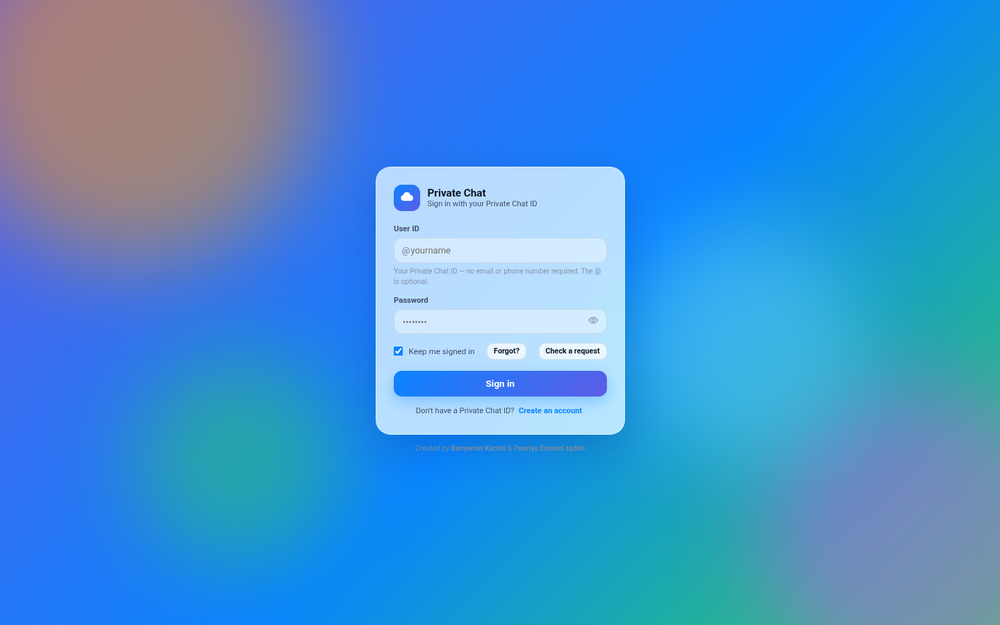
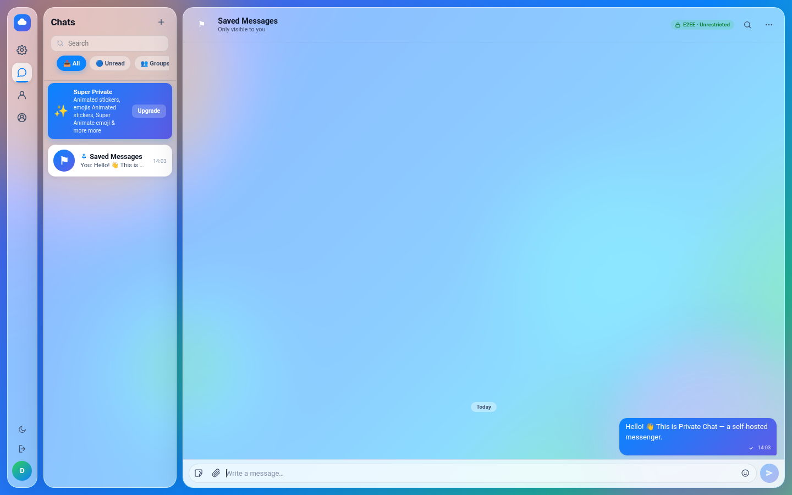
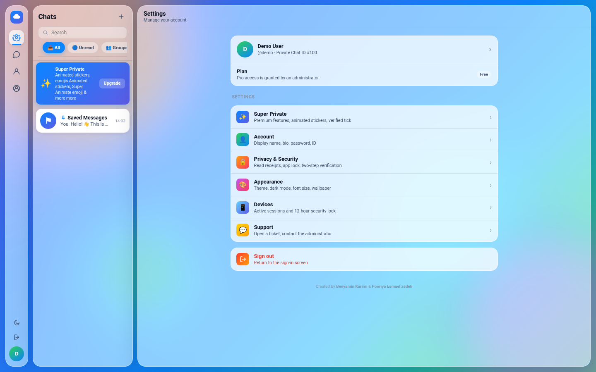
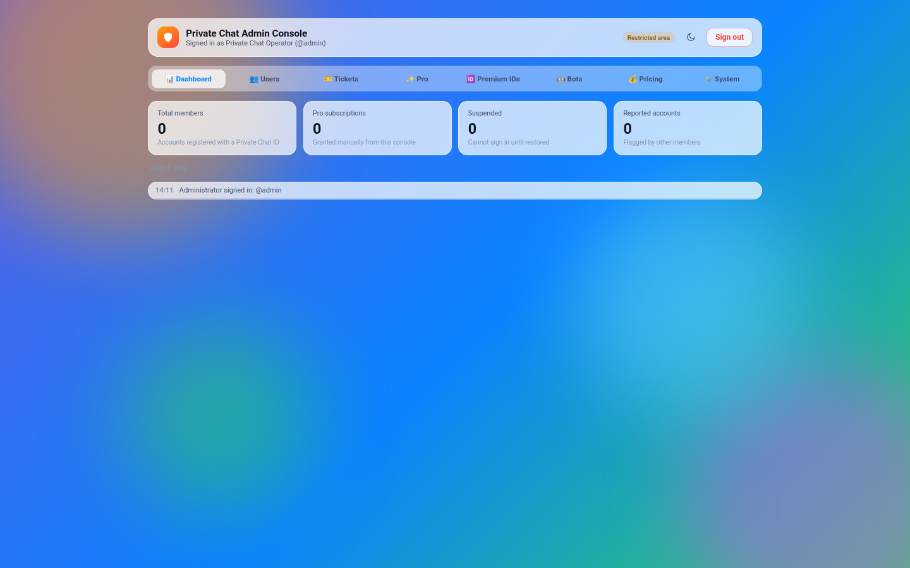

<div align="center">

# 🔐 چت خصوصی — پیام‌رسان شیشه‌ای (Glass Messenger)

**یک پیام‌رسان سلف‌هاست با فرانت‌اند تک‌فایلی و بک‌اند واقعی PHP. بدون CDN، بدون سرویس خارجی، بدون مرحله‌ی build — روی هر هاستی بالا می‌آید، حتی هاست اشتراکی ایران.**

[](https://www.php.net/)
[](https://www.sqlite.org/)
[](index.html)
[](#-نصب-۵-دقیقه)
[]()
[](LICENSE)

**|** [](README.md)

**🌐 صفحه‌ی پروژه:** [metora.ir/private-chat](https://metora.ir/private-chat)

</div>

---

## 📖 معرفی

Private Chat یک پیام‌رسان کامل است که به‌صورت **یک فایل `index.html`** به‌همراه **یک بک‌اند کوچک PHP** عرضه می‌شود. فرانت‌اند یک اپلیکیشن تک‌صفحه‌ای با طراحی گلس‌مورفیسم است و بک‌اند فقط یک نقطه‌ی ورود API (`api.php`) دارد که با SQLite (پیش‌فرض) یا MySQL کار می‌کند.

- **صفر وابستگی خارجی** — بدون CDN، بدون فونت گوگل، بدون فایربیس و بدون هیچ جاوااسکریپت شخص ثالث. همه‌ی فایل‌ها inline شده‌اند؛ اپ آفلاین و پشت هر فایروالی کار می‌کند.
- **حساب‌های واقعی** — کاربران با **شناسه‌ی Private Chat** ثبت‌نام می‌کنند (بدون ایمیل و شماره تلفن)، روی هر دستگاهی وارد می‌شوند و ۳۰ روز روی همان دستگاه می‌مانند.
- **بازگشت بی‌صدا (fallback)** — اگر سرور در دسترس نباشد، اپ خودکار به **حالت محلی (local mode)** با حافظه‌ی مرورگر برمی‌گردد؛ هیچ پیام خطایی روی صفحه نمی‌آید.

| صفحه‌ی ورود | پیام‌رسان | تنظیمات | پنل ادمین |
| :---: | :---: | :---: | :---: |
|  |  |  |  |

## ✨ ویژگی‌ها

**پیام‌رسانی**
- 💬 **چت خصوصی ۱:۱** با تحویل واقعی پیام بین دو حساب (همگام‌سازی هر ۳ ثانیه)
- 🗑️ **حذف برای همه** — حذف پیام برای طرف مقابل هم اعمال می‌شود
- ⚑ **Saved Messages** — دفترچه‌ی یادداشت شخصی داخل هر حساب
- 🖼️ **عکس، فایل، استیکر، ایموجی** و استیکرهای متحرک
- 📝 **همگام‌سازی با ادغام هوشمند** — پیش‌نویس‌ها، چت‌ها و تنظیمات بین دستگاه‌ها بدون گم‌شدن ادغام می‌شوند

**گروه و کانال**
- 👥 **گروه و کانال** با درخواست عضویت و تأیید ادمین
- 🛠️ مدیریت اعضا: ارتقا / تنزل / حذف عضو
- 📢 ارسال پیام گروهی برای مالکان کانال

**حساب و اشتراک**
- 🆔 **شناسه‌ی Private Chat** — شناسه‌های @نام کاربری، بدون شماره تلفن
- ✨ **Super Private (Pro)** — پلن‌های اشتراک، استیکر متحرک، تیک تأیید و بج طلایی؛ همه از پنل ادمین مدیریت می‌شود
- 🏅 **درخواست شناسه‌ی پرمیوم** — شناسه‌های کوتاه ۳–۴ حرفی قابل فروش توسط اپراتور
- 🤖 **PrivateAI** — دستیار هوش مصنوعی داخلی (اندپوینت سازگار با OpenAI؛ از پنل ادمین تنظیم می‌شود)

**مدیریت**
- 🛡️ **پنل ادمین** — حساب‌ها، درخواست‌های Pro، اشتراک‌ها، تیکت‌ها، تنظیمات ربات/هوش مصنوعی، قیمت‌گذاری
- 🎫 **تیکت پشتیبانی** — کاربر تیکت می‌سازد، ادمین پاسخ می‌دهد و بسته می‌کند
- 📊 **Diagnostics & self-test** — گزارش سلامت دیتابیس و سرور، مخصوص ادمین
- 🧹 **ابزار پاک‌سازی** — ریست دیتای یک حساب یا پاک‌سازی کامل

**ظاهر**
- 🎨 **رابط گلس‌مورفیسم** با ده‌ها تم، والپیپر و حالت تاریک
- 🌐 چیدمان **سازگار با راست‌به‌چپ** و پشتیبانی دوزبانه از رابط کاربری
- 📱 واکنش‌گرا — روی موبایل، تبلت و دسکتاپ کار می‌کند

## 🧱 معماری

```
┌────────────────────────┐      POST api.php (JSON)       ┌─────────────────────┐
│  index.html            │ ─────────────────────────────▶ │  api.php            │
│  (SPA با رابط شیشه‌ای)  │ ◀───────────────────────────── │  (نقطه‌ی ورود یکتا)  │
│                        │        پاسخ‌های JSON           │  ├─ lib.php         │
│  حالت محلی fallback    │                                │  ├─ config.php      │
│  (حافظه‌ی مرورگر)       │                                │  └─ درایور PDO      │
└────────────────────────┘                                └─────────┬───────────┘
                                                                    │
                                          فایل SQLite (پیش‌فرض)      │  MySQL / MariaDB
                                          data/privatechat.sqlite   │  schema.sql
```

- **`index.html`** — کل اپلیکیشن: رابط کاربری، منطق، تم‌ها. بک‌اند را خودکار پیدا می‌کند و بین *حالت سرور* و *حالت محلی* سوئیچ می‌شود.
- **`api.php`** — تنها اندپوینت API. هر درخواست `POST` با بدنه‌ی JSON و کلید `action` است.
- **`lib.php`** — کتابخانه‌ی پایه: راه‌اندازی دیتابیس، ساخت جدول‌ها، سشن‌ها، تحویل پیام، ادغام دیتا.
- **`config.php`** — تنها فایلی که ویرایش می‌کنید (دیتابیس + حساب ادمین اول).
- **`install.php`** — صفحه‌ی اختیاری نصب و گزارش سلامت. بعد از نصب حذفش کنید.
- **`schema.sql`** — همان جدول‌ها برای راه‌اندازی دستی MySQL در phpMyAdmin.

**جدول‌های دیتابیس (ساخت خودکار):** `users`، `sessions`، `app_state`، `messages`، `chat_index`، `chat_members`، `chat_messages`، `join_requests`، `tickets`، `user_aliases`، `ai_usage`، `login_fails`

## 📦 نصب (۵ دقیقه)

> روی هر هاستی با PHP کار می‌کند: cPanel، DirectAdmin، VPS یا برای تست `php -S localhost:8000`.

**نیازمندی‌ها**
- PHP نسخه‌ی **7.1 تا 8.3** با افزونه‌ی **PDO** (`pdo_sqlite` یا `pdo_mysql`)
- چیز دیگری لازم نیست — بدون Composer، بدون Node.js، بدون دسترسی SSH

**مراحل**

1. فایل‌های ریپو را در `public_html` (یا زیرپوشه‌ای مثل `public_html/chat`) آپلود کنید.
2. فایل **`config.php`** را ویرایش کنید:
   ```php
   define('DB_DRIVER', 'sqlite');   // پیش‌فرض؛ اگر MySQL می‌خواهید 'mysql'
   define('ADMIN_PASS', 'یک-رمز-قوی');  // حتماً تغییر دهید!
   ```
   با حالت `sqlite` کار تمام است — فایل دیتابیس، جدول‌ها و حساب ادمین در اولین اجرا خودکار ساخته می‌شوند.
   *برای MySQL:* در cPanel یک دیتابیس و کاربر بسازید (**ALL PRIVILEGES**)، سپس `DB_NAME`، `DB_USER` و `DB_PASS` را پر کنید و `DB_DRIVER` را روی `'mysql'` بگذارید.
3. آدرس `https://yourdomain.ir/install.php` را باز کنید — همه‌ی تیک‌ها باید سبز شود.
4. **`install.php` را از سرور حذف کنید.**
5. `https://yourdomain.ir/` را باز کنید و با `admin` وارد شوید یا حساب جدید بسازید.

> 💡 در حالت SQLite پوشه‌ی `data/` باید قابل نوشتن باشد (اول `chmod 755`، اگر نشد `777`). فایل `.htaccess` همه‌ی دسترسی وب به فایل دیتابیس، کانفیگ و لاگ‌ها را می‌بندد.

**اجرای محلی برای تست**

```bash
php -S localhost:8000
# سپس http://localhost:8000/index.html را باز کنید
```

> 💡 بدون بک‌اند، اپ در **حالت محلی** اجرا می‌شود و یک حساب ادمین نمایشی داخل مرورگر خودتان می‌سازد — شناسه `admin` و رمز `local-admin`. این حساب فقط در حافظه‌ی همان مرورگر وجود دارد و هیچ ربطی به حساب‌های سرور ندارد.

## 🔌 مستندات API

همه‌ی درخواست‌ها: `POST api.php` با بدنه‌ی JSON و کلید `action`. اکشن‌های احراز هویت‌شده، توکن ۶۴ کاراکتری سشن (`token`) را می‌پذیرند. اکشن‌های ادمین فقط با حساب ادمین داخلی کار می‌کنند.

<details>
<summary><strong>فهرست کامل اکشن‌ها (بیش از ۵۵ اکشن)</strong> — برای باز شدن کلیک کنید</summary>

| اکشن | ورودی | کار |
|---|---|---|
| `ping` | — | آماده بودن سرور و نصب |
| **احراز هویت** | | |
| `auth.register` | name, id, pass | ثبت‌نام + توکن |
| `auth.login` | id, pass | ورود + توکن |
| `auth.me` | token | اطلاعات حساب جاری |
| `auth.logout` | token | خروج از دستگاه جاری |
| `auth.changePassword` | old, new | تغییر رمز (باطل‌کردن سشن‌های دیگر) |
| `account.delete` | token | حذف حساب خودم |
| **پیام‌رسانی** | | |
| `msg.send` | items[] | تحویل پیام / دستور حذف برای همه |
| `msg.fetch` | since | گرفتن پیام‌های نرسیده |
| `msg.cursor` | — | آخرین شماره‌ی پیام دریافتی |
| **همگام‌سازی دیتا** | | |
| `state.pull` | token | گرفتن دیتای حساب |
| `state.push` | version, data | ذخیره با ادغام هوشمند |
| **چت و مخاطبین** | | |
| `chat.find` / `user.find` / `user.aliases` | id | پیدا کردن حساب‌ها |
| `chat.history` | chat id | تاریخچه‌ی پیام‌ها |
| `profile.update` | fields | نام، بیو، سطح نمایش عکس |
| `profile.uploadAvatar` | image | آپلود عکس پروفایل |
| **گروه و کانال** | | |
| `chat.register` | type, title | ساخت گروه / کانال |
| `chat.join` / `chat.requests` / `chat.approve` / `chat.decline` | chat id | عضویت با تأیید ادمین |
| `chat.post` / `chat.canPost` | chat id, text | ارسال پیام (با رعایت مجوز کانال) |
| `chat.members` / `chat.promote` / `chat.demote` / `chat.kick` | chat id, uid | مدیریت اعضا |
| **Pro و پرمیوم** | | |
| `pro.submit` / `pro.requestId` | plan / id | اشتراک Pro، درخواست شناسه‌ی پرمیوم |
| `pricing.get` | — | پلن‌های قیمت فعلی |
| `admin.proRequests` / `admin.approvePro` / `admin.declinePro` | — | مدیریت درخواست‌های Pro |
| `admin.proIdRequests` / `admin.approveProId` / `admin.declineProId` | — | مدیریت شناسه‌های پرمیوم |
| `admin.setProTier` / `admin.setGold` / `admin.setVerified` / `admin.messagePro` | uid | وضعیت اعضا |
| `admin.setPricing` | plans | به‌روزرسانی قیمت‌ها |
| **تیکت‌ها** | | |
| `ticket.create` / `ticket.createAuthed` / `ticket.my` / `ticket.track` / `ticket.list` / `ticket.update` | … | چرخه‌ی تیکت پشتیبانی |
| **مدیریت** | | |
| `admin.syncUsers` | users[] | همگام‌سازی وضعیت / Pro از پنل |
| `admin.deleteUser` | uid | حذف کامل حساب — **شناسه آزاد می‌شود** |
| `admin.setPassword` | uid, pass | ریست رمز یک عضو |
| `admin.reset` / `admin.wipeAll` / `admin.restart` | — | ابزارهای پاک‌سازی |
| `admin.getBotConfig` / `admin.setBotConfig` | config | تنظیمات ربات / هوش مصنوعی |
| **هوش مصنوعی و متفرقه** | | |
| `ai.chat` / `ai.status` | text | دستیار PrivateAI (سهمیه‌ی هر حساب) |
| `sessions.list` / `sessions.terminate` | token | مدیریت سشن‌های دستگاه‌ها |
| `botconfig.get` / `bot.animate` | — | ابزارهای اتصال ربات |

</details>

## 🔒 امنیت

- 🛡️ **همه‌ی کوئری‌ها prepared statement هستند** — هیچ سطح حمله‌ی SQL injection وجود ندارد
- 🔑 رمزها با **bcrypt** (`password_hash`) هش می‌شوند و هرگز به مرورگر برنمی‌گردند
- 🎫 **توکن سشن ۶۴ کاراکتری** از `random_bytes`، اعتبار ۳۰ روزه، یک ردیف برای هر دستگاه
- 🚦 **محدودسازی ورود** — حداکثر ۱۰ تلاش ناموفق در ۵ دقیقه برای هر IP/شناسه (`login_fails`)
- 🧨 کاربر بلاک‌شده همان لحظه از **همه‌ی دستگاه‌ها** بیرون انداخته می‌شود؛ تغییر رمز، بقیه‌ی سشن‌ها را باطل می‌کند
- 🚫 فایل `.htaccess` دسترسی وب به فایل‌های `.sqlite`، `.db`، `.log` و `.sql` را می‌بندد و لیست فایل‌ها را خاموش می‌کند
- 🧹 اندپوینت وضعیت سرور از صفحه‌ی ورود حذف شده تا اطلاعاتی لو نرود
- ✅ پشت HTTPS اجرا کنید (Let's Encrypt رایگان در cPanel) تا رمزها به‌صورت متن آشکار رد و بدل نشوند

## 🌍 چرا همه‌جا کار می‌کند

اپ **هیچ سرویس خارجی صدا نمی‌زند** — بدون CDN، بدون فونت گوگل، بدون آنالیتیکس، بدون API ابری (به‌جز اندپوینت اختیاری هوش مصنوعی خودتان). همه‌چیز داخل فایل‌های HTML و PHP قرار دارد، بنابراین:

- روی **هر هاست اشتراکی ایران** بدون مشکل تحریم و فیلترینگ بالا می‌آید،
- در شبکه‌های **آفلاین / اینترانت** هم کار می‌کند،
- و هیچ اطلاعاتی از بازدیدکنندگان به اشخاص ثالث نمی‌رود.

## 🛠️ رفع اشکال سریع

| مشکل | علت / راه‌حل |
|---|---|
| `install.php` می‌گوید driver پیدا نشد | در cPanel → *Select PHP Version* افزونه‌ی `pdo_sqlite` یا `pdo_mysql` را فعال کنید |
| خطای اتصال دیتابیس | در هاست‌های اشتراکی نام دیتابیس/کاربر معمولاً پیشوند اکانت دارد: `user_dbname` |
| صفحه‌ی سفید | در `config.php` مقدار `DEBUG_ERRORS` را `true` کنید، خطا را ببینید، بعد `false` کنید |
| تغییرات را نمی‌بینم | یک‌بار hard refresh: `Ctrl+Shift+R` (موبایل: پاک‌کردن کش مرورگر) |
| خطای نوشتن SQLite | پوشه‌ی `data/` را قابل نوشتن کنید (`chmod 755`، در صورت نیاز `777`) |
| اپ پیام local mode می‌دهد | بک‌اند در دسترس نیست — مسیر `api.php` و فعال‌بودن PHP روی هاست را چک کنید |

## 🗺️ نقشه‌ی راه

- [ ] رمزنگاری سرتاسری برای چت‌های ۱:۱
- [ ] پیام صوتی
- [ ] نوتیفیکیشن وب‌پوش
- [ ] بسته‌های زبانی بیشتر

## 🤝 مشارکت

Issue و Pull Request خوش‌آمدید! برای تغییرات بزرگ لطفاً اول یک Issue باز کنید تا درباره‌ی تغییر موردنظر گفتگو کنیم.

## 📄 لایسنس

منتشرشده تحت [لایسنس MIT](LICENSE).

---

<div align="center">

**ساخته‌شده توسط بنیامین کریمی و پوریا اسماعیل‌زاده**

⭐ اگر برایتان مفید بود، به ریپو ستاره بدهید!

</div>
