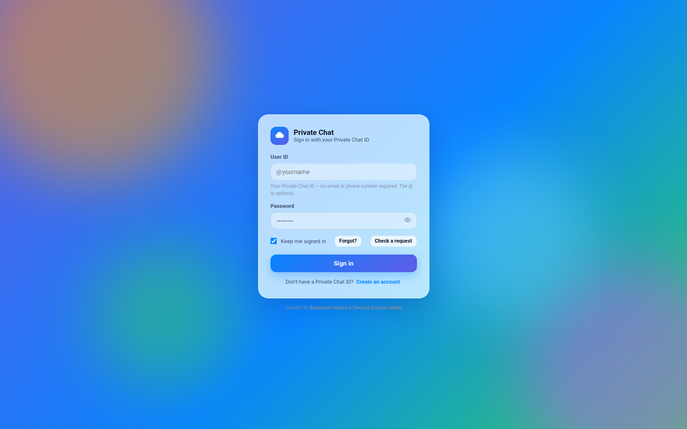
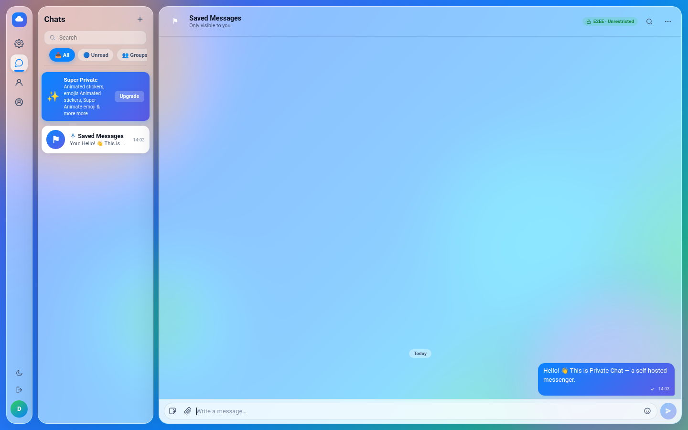
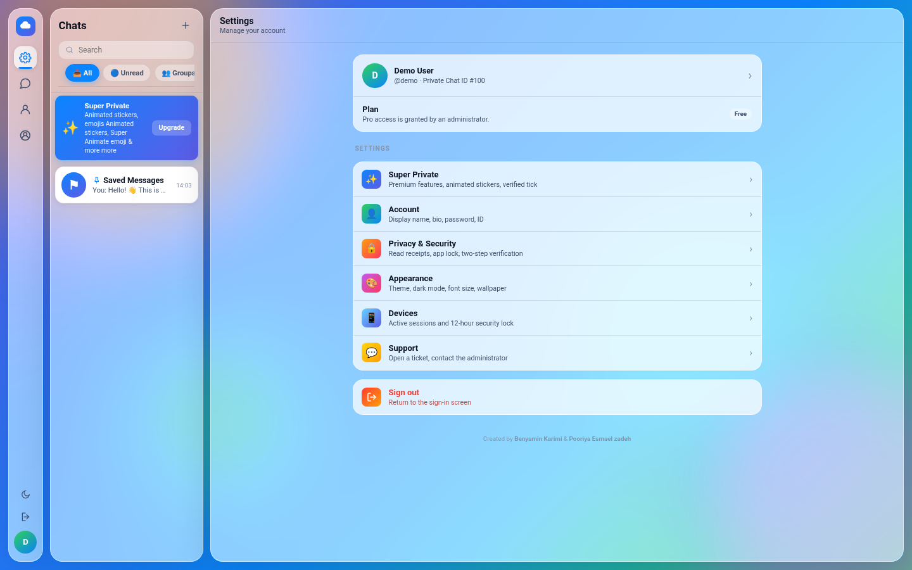
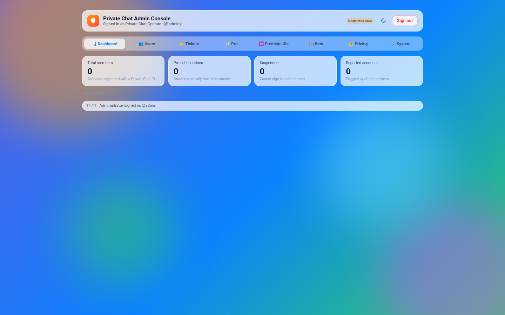

<div align="center">

# 🔐 Private Chat — Glass Messenger

**A self-hosted, single-file messenger with a real PHP backend. No CDN, no external services, no build step — it runs anywhere, including Iranian shared hosting.**

[](https://www.php.net/)
[](https://www.sqlite.org/)
[](index.html)
[](api.php)
[](#-installation-5-minutes)
[](#-why-it-works-everywhere)
[](LICENSE)

[](README-fa.md) **| فارسی**

**🌐 Project page:** [metora.ir/private-chat](https://metora.ir/private-chat)

</div>

---

## 📖 Overview

Private Chat is a full messenger that ships as **one `index.html` file** plus a **small PHP backend**. The frontend is a glassmorphism single-page app; the backend is a single API entry point (`api.php`) backed by SQLite (default) or MySQL.

- **Zero external dependencies** — no CDN, no Google Fonts, no Firebase, no third-party JS. Every asset is inlined, so the app works offline and behind any firewall.
- **Real accounts** — users register with a **Private Chat ID** (no email or phone), sign in on any device, and stay signed in for 30 days per device.
- **Graceful fallback** — if the server is unreachable, the app silently switches to **local mode** using browser storage. No error screens, ever.

| Login | Messenger | Settings | Admin console |
| :---: | :---: | :---: | :---: |
|  |  |  |  |

## ✨ Features

**Messaging**
- 💬 **1:1 chats** with real delivery between accounts (server sync every 3 seconds)
- 🗑️ **Delete for everyone** — deletions propagate to the other side
- ⚑ **Saved Messages** — a private cloud notebook inside every account
- 🖼️ **Images, files, stickers, emojis** and animated stickers
- 📝 **Smart merge sync** — drafts, chats and settings merge safely across devices

**Groups & channels**
- 👥 **Groups & channels** with join requests and admin approval
- 🛠️ Member management: promote / demote / kick
- 📢 Broadcast-style posting for channel owners

**Accounts & premium**
- 🆔 **Private Chat ID** — `@name` style identifiers, no phone number
- ✨ **Super Private (Pro)** — subscription tiers, animated stickers, verified tick and gold badges, managed by the admin
- 🏅 **Premium ID requests** — short 3–4 character IDs can be sold by the operator
- 🤖 **PrivateAI** — built-in AI assistant (configurable OpenAI-compatible endpoint, set from the admin panel)

**Administration**
- 🛡️ **Admin panel** — accounts, Pro requests, subscriptions, tickets, bot/AI config, pricing
- 🎫 **Support tickets** — users open tickets, admin replies and resolves
- 📊 **Diagnostics & self-test** — health report for the database and server, visible to the admin
- 🧹 **Wipe / reset tools** — per-account data reset or global wipe

**Look & feel**
- 🎨 **Glassmorphism UI** with dozens of themes, wallpapers and dark mode
- 🌐 **Right-to-left friendly** layout, bilingual UI support
- 📱 Responsive — works on phones, tablets and desktop

## 🧱 Architecture

```
┌────────────────────────┐         POST api.php (JSON)          ┌─────────────────────┐
│  index.html            │ ───────────────────────────────────▶ │  api.php            │
│  (SPA, glass UI)       │ ◀─────────────────────────────────── │  (single entry)     │
│                        │            JSON responses            │  ├─ lib.php         │
│  local mode fallback   │                                      │  ├─ config.php      │
│  (browser storage)     │                                      │  └─ PDO driver      │
└────────────────────────┘                                      └─────────┬───────────┘
                                                                          │
                                                     SQLite file (default) │  MySQL / MariaDB
                                                     data/privatechat.sqlite│  schema.sql
```

- **`index.html`** — the whole app: UI, logic, themes. Detects the backend automatically and switches between *server mode* and *local mode*.
- **`api.php`** — the only API endpoint. Every request is `POST` with a JSON body and an `action` key.
- **`lib.php`** — core library: DB bootstrap, tables, sessions, message delivery, state merge.
- **`config.php`** — the only file you edit (database + first admin account).
- **`install.php`** — optional one-page installer/health report. Delete it after installing.
- **`schema.sql`** — the same tables for a manual MySQL setup via phpMyAdmin.

**Database tables (auto-created):** `users`, `sessions`, `app_state`, `messages`, `chat_index`, `chat_members`, `chat_messages`, `join_requests`, `tickets`, `user_aliases`, `ai_usage`, `login_fails`

## 📦 Installation (5 minutes)

> Works on any host with PHP: cPanel, DirectAdmin, VPS, or `php -S localhost:8000` for testing.

**Requirements**
- PHP **7.1 – 8.3** with the **PDO** extension (`pdo_sqlite` or `pdo_mysql`)
- Nothing else — no Composer, no Node.js, no SSH access

**Steps**

1. Upload the repository files to `public_html` (or any subfolder like `public_html/chat`).
2. Edit **`config.php`**:
   ```php
   define('DB_DRIVER', 'sqlite');   // default; use 'mysql' if you prefer
   define('ADMIN_PASS', 'your-strong-password');  // CHANGE THIS!
   ```
   With `sqlite` you are done — the database file, tables and admin account are created automatically on first run.
   *For MySQL:* create a database + user in cPanel (**ALL PRIVILEGES**), then fill `DB_NAME`, `DB_USER`, `DB_PASS` and set `DB_DRIVER` to `'mysql'`.
3. Open `https://yourdomain.com/install.php` — all checks should be green.
4. **Delete `install.php` from the server.**
5. Open `https://yourdomain.com/` and sign in as `admin`, or create a new account.

> 💡 On SQLite, the `data/` folder must be writable (try `chmod 755`, then `777` if needed). The `.htaccess` file blocks all web access to the database file, config and logs.

**Run locally for testing**

```bash
php -S localhost:8000
# then open http://localhost:8000/index.html
```

> 💡 Without a backend the app runs in **local mode** and seeds a demo admin account inside your own browser — ID `admin`, password `local-admin`. This account exists only in that browser's storage and has nothing to do with the server accounts.

## 🔌 API Reference

All requests: `POST api.php`, JSON body, with an `action` key. Authenticated actions expect the 64-character session `token`. The admin actions require the built-in admin account.

<details>
<summary><strong>Full action list (55+ actions)</strong> — click to expand</summary>

| Action | Input | Description |
|---|---|---|
| `ping` | — | Server readiness / install check |
| **Authentication** | | |
| `auth.register` | name, id, pass | Create account, returns token |
| `auth.login` | id, pass | Sign in, returns token |
| `auth.me` | token | Current account info |
| `auth.logout` | token | Sign out current device |
| `auth.changePassword` | old, new | Change own password (revokes other sessions) |
| `account.delete` | token | Delete own account |
| **Messaging** | | |
| `msg.send` | items[] | Deliver messages / delete-for-everyone commands |
| `msg.fetch` | since | Fetch undelivered messages |
| `msg.cursor` | — | Latest received message number |
| **State sync** | | |
| `state.pull` | token | Pull this account's data |
| `state.push` | version, data | Push with smart merge |
| **Chats & contacts** | | |
| `chat.find` / `user.find` / `user.aliases` | id | Look up accounts |
| `chat.history` | chat id | Message history |
| `profile.update` | fields | Name, bio, photo visibility |
| `profile.uploadAvatar` | image | Upload profile photo |
| **Groups & channels** | | |
| `chat.register` | type, title | Create group / channel |
| `chat.join` / `chat.requests` / `chat.approve` / `chat.decline` | chat id | Join flow with approval |
| `chat.post` / `chat.canPost` | chat id, text | Post (channel permission aware) |
| `chat.members` / `chat.promote` / `chat.demote` / `chat.kick` | chat id, uid | Member management |
| **Pro & premium** | | |
| `pro.submit` / `pro.requestId` | plan / id | Subscribe to Pro, request premium ID |
| `pricing.get` | — | Current pricing plans |
| `admin.proRequests` / `admin.approvePro` / `admin.declinePro` | — | Handle Pro subscriptions |
| `admin.proIdRequests` / `admin.approveProId` / `admin.declineProId` | — | Handle premium ID requests |
| `admin.setProTier` / `admin.setGold` / `admin.setVerified` / `admin.messagePro` | uid | Member flags |
| `admin.setPricing` | plans | Update pricing |
| **Tickets** | | |
| `ticket.create` / `ticket.createAuthed` / `ticket.my` / `ticket.track` / `ticket.list` / `ticket.update` | … | Support ticket flow |
| **Admin** | | |
| `admin.syncUsers` | users[] | Sync status / Pro from panel |
| `admin.deleteUser` | uid | Delete account — the ID is freed again |
| `admin.setPassword` | uid, pass | Reset a member's password |
| `admin.reset` / `admin.wipeAll` / `admin.restart` | — | Data reset tools |
| `admin.getBotConfig` / `admin.setBotConfig` | config | AI / bot settings |
| **AI & misc** | | |
| `ai.chat` / `ai.status` | text | PrivateAI assistant (per-account quota) |
| `sessions.list` / `sessions.terminate` | token | Device session management |
| `botconfig.get` / `bot.animate` | — | Bot integration helpers |

</details>

## 🔒 Security

- 🛡️ **Prepared statements everywhere** — no SQL injection surface
- 🔑 Passwords hashed with **bcrypt** (`password_hash`), never returned to the browser
- 🎫 **64-character session tokens** from `random_bytes`, 30-day validity, one row per device
- 🚦 **Login throttling** — max 10 failed attempts per 5 minutes per IP/ID (`login_fails`)
- 🧨 Blocked users are kicked from **all devices instantly**; changing a password revokes other sessions
- 🚫 `.htaccess` denies web access to `.sqlite`, `.db`, `.log`, `.sql` files and disables directory listing
- 🧹 The health/status endpoint was deliberately removed from the login screen to avoid information leaks
- ✅ Run behind HTTPS (free Let's Encrypt on cPanel) so credentials never travel in plain text

## 🌍 Why it works everywhere

The app calls **no external service at all** — no CDN, no Google Fonts, no analytics, no cloud APIs (except your own optional AI endpoint). Everything is inlined in the HTML and PHP files, so:

- it boots on **any Iranian shared host** without sanctions or filtering problems,
- it keeps working on **offline / intranet** setups,
- and it never leaks visitor data to third parties.

## 🛠️ Troubleshooting

| Problem | Cause / fix |
|---|---|
| `install.php` says driver not found | Enable `pdo_sqlite` or `pdo_mysql` in cPanel → *Select PHP Version* |
| Database connection error | On shared hosts the DB name/user usually has an account prefix: `user_dbname` |
| Blank page | Set `DEBUG_ERRORS` to `true` in `config.php`, reproduce, then set it back to `false` |
| Changes not visible | Hard refresh: `Ctrl+Shift+R` (mobile: clear browser cache) |
| SQLite write error | Make `data/` writable (`chmod 755`, fallback `777`) |
| App shows "local mode" | The backend is unreachable — check `api.php` path and that the host serves PHP |

## 🗺️ Roadmap

- [ ] End-to-end encryption for 1:1 chats
- [ ] Voice messages
- [ ] Web push notifications
- [ ] Multi-language UI packs

## 🤝 Contributing

Issues and pull requests are welcome! For big changes, please open an issue first to discuss what you would like to change.

## 📄 License

Released under the [MIT License](LICENSE).

---

<div align="center">

**Created by Benyamin Karimi & Pooriya Esmael zadeh**

⭐ Star this repo if it helped you!

</div>
